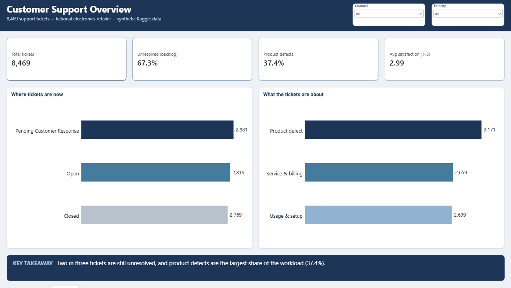
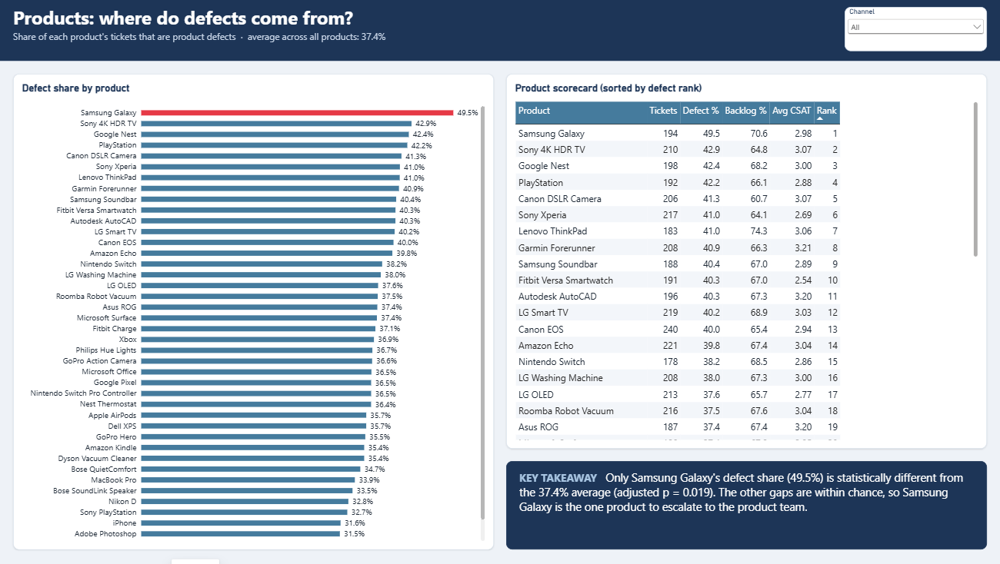
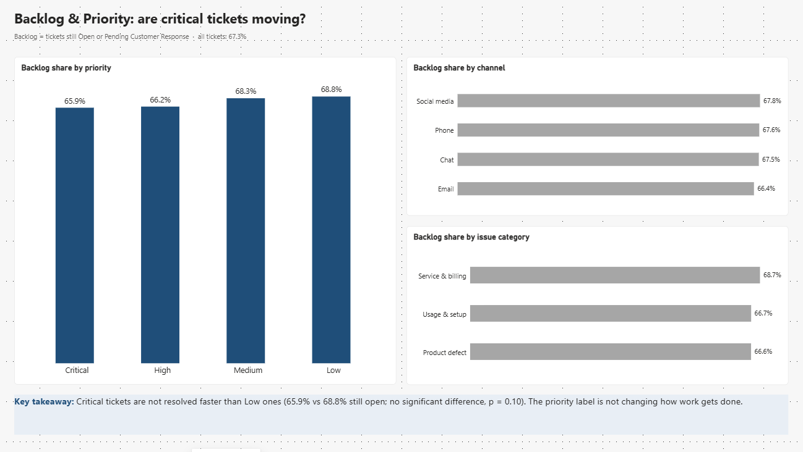

# Customer Support Ticket Analysis

**An end-to-end analysis of 8,469 support tickets: cleaned in Excel, queried in SQL Server, tested in Python, and presented in Power BI.**



## The business question

A Head of Customer Support at a fictional electronics retailer asks:

> *Which products are causing the most problems for support, is it the product's fault or our service, and are tickets being handled in the right order?*

The data is a public, synthetic Kaggle dataset of customer support tickets. Treating it as a real request shapes every step. The analysis starts from the stakeholder's question rather than from the columns, every finding is tested before it is reported, and the project ends with a recommendation instead of a chart.

## Key findings

| # | Finding | Evidence |
|---|---------|----------|
| 1 | **Samsung Galaxy is the one product with a real defect problem.** 49.5% of its tickets are product defects, against a 37.4% average. | Two-proportion z-test, still significant after a Bonferroni correction for 42 products (adjusted p = 0.019). A permutation test agrees. |
| 2 | **Marking a ticket Critical does not get it resolved faster.** 65.9% of Critical tickets are still open, compared with 68.8% of Low ones. | No significant difference across priorities (chi-square, p = 0.10). The pattern holds within each issue category. |
| 3 | **Two in three tickets are unresolved** (67.3%), and the backlog is spread evenly across channels and problem types. | The descriptive SQL analysis shows no channel or category standing out. |
| 4 | **Satisfaction differences between channels and products are noise.** | Chi-square on the rating distribution: channel p = 0.47, product p = 0.25. |

## Recommendations

1. **Escalate Samsung Galaxy to the product team.** It is the only product difference that survived testing.
2. **Fix how priority is used.** Audit how the Critical label is assigned and routed, and track a target resolution time for each priority.
3. **Stop chasing satisfaction by channel or product.** Invest instead in reliable timestamps and in capturing the reason behind each rating.

📄 [Executive summary (PDF)](reports/executive_summary.pdf) · [PowerPoint version](reports/executive_summary.pptx)

## How it was built

| Stage | Tool | What happened | Output |
|-------|------|---------------|--------|
| 1. Cleaning | Excel + Power Query | Profiled every column, investigated why values were missing, removed personal data, mapped 16 subjects into 3 issue categories, and documented every decision. | [Data quality log](docs/data_quality_log.md) · [Data dictionary](docs/data_dictionary.md) · [Clean CSV](data/clean/tickets_clean.csv) |
| 2. Business questions | SQL Server (T-SQL) | Built a re-runnable load and validation script, then answered the workload, product, backlog and satisfaction questions. A view feeds Power BI. | [SQL scripts](sql/) · [SQL findings](docs/sql_findings.md) |
| 3. Is it real or noise? | Python (pandas, SciPy) | Tested every SQL finding with chi-square, two-proportion z-tests, Bonferroni correction and a permutation test. | [Notebook](notebooks/03_significance_tests.ipynb) · [Statistical findings](docs/stats_findings.md) |
| 4. Dashboard | Power BI (PBIP) | Three pages (Overview, Products, Backlog & Priority), each with a written takeaway. Saved as a Power BI Project so the model and report are readable text files in Git. | [Power BI project](powerbi/TicketSupport/) |
| 5. Executive summary | PowerPoint | Seven slides: the findings, the three recommendations and the limits of the data. | [PDF](reports/executive_summary.pdf) |

## Decisions worth highlighting

- **Not every blank is missing data.** About 5,700 blanks belonged to tickets that were not finished yet: Open and Pending tickets have no resolution or rating. They were kept as nulls, not deleted or filled.
- **Choosing not to answer a question.** In 1,365 of 2,769 closed tickets the "resolution" happens before the first response, and there is no ticket-created timestamp. Response and resolution speed were therefore left out of the analysis.
- **Proportions, not volumes.** Canon EOS has the most tickets but may simply sell more, and there is no sales data. Products are compared on the *share* of their tickets that are defects.
- **Test before you recommend.** Three products looked like "problem products" in SQL. Only one survived the statistical tests.

## More from the dashboard

| Products | Backlog & Priority |
|---|---|
|  |  |

## Repository structure

```
├── data/
│   ├── raw/                 # original Kaggle CSV (never edited)
│   ├── clean/               # cleaned dataset used by every later stage
│   └── reference/           # subject → issue category mapping
├── excel/                   # Power Query cleaning workbook
├── sql/                     # 01_setup … 06_product_scorecard (T-SQL)
├── notebooks/               # significance tests (Python)
├── powerbi/TicketSupport/   # Power BI Project (TMDL model + PBIR report)
├── reports/                 # executive summary (PPTX + PDF)
├── docs/                    # data quality log, data dictionary, findings
├── images/                  # charts and dashboard screenshots
└── linkedin/                # the posts that documented each stage
```

## How to reproduce

1. **Cleaning:** open `excel/ticket_analysis.xlsx` and refresh. It reads `data/raw/customer_support_tickets.csv`.
2. **SQL:** in SSMS, connected to a local SQL Server, run `sql/01_setup.sql`. Update the `BULK INSERT` path to point at your copy of `data/clean/tickets_clean.csv`. Then run scripts `02` to `06`.
3. **Python:** `pip install -r requirements.txt`, then open `notebooks/03_significance_tests.ipynb` and choose *Restart & Run All*.
4. **Power BI:** open `powerbi/TicketSupport/TicketSupport.pbip` and click **Refresh**. It connects to the `TicketSupport` database on `localhost`.

## Limitations

- The dataset is **synthetic**: most categories are split almost evenly, so few patterns are strong. The value of this project is the method, which carries over to real data.
- **Timestamps are unreliable**, so there is no analysis of resolution speed.
- There is **no sales or team data**, so defects per unit sold and workload per agent could not be measured.

## Tools

Excel · Power Query · SQL Server 2025 · T-SQL · Python · pandas · SciPy · Matplotlib · Jupyter · Power BI · DAX · PowerPoint · Git
