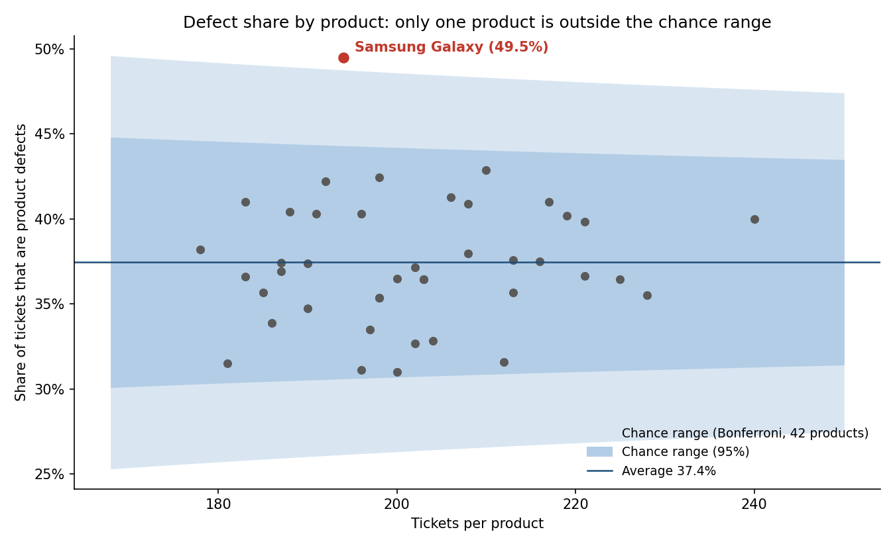
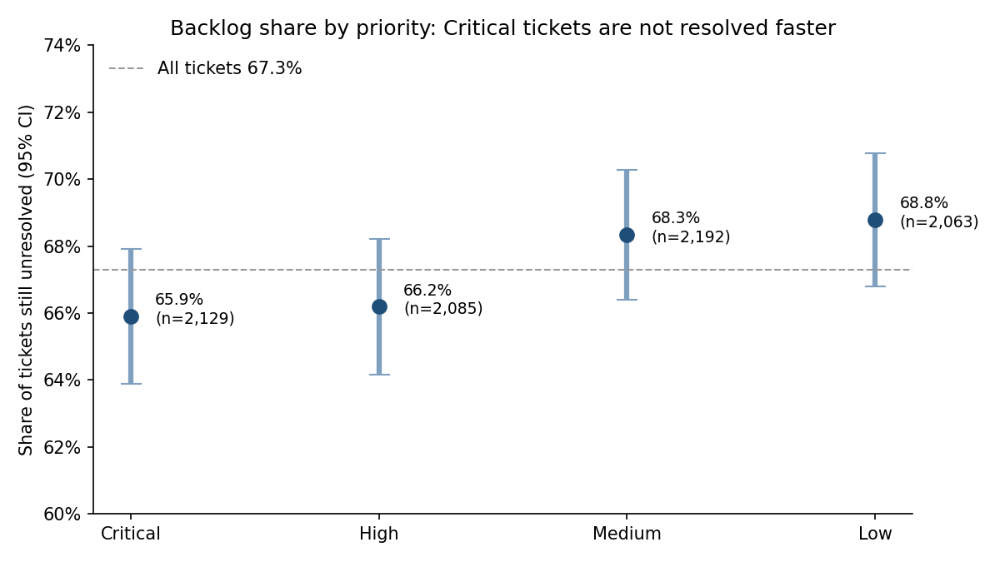

# Stage 3 — Statistical Findings

**Notebook:** [`notebooks/03_significance_tests.ipynb`](../notebooks/03_significance_tests.ipynb) (Python: pandas, SciPy, Matplotlib)
**Purpose:** test whether the Stage 2 differences ([sql_findings.md](sql_findings.md)) are real or just chance, before anyone acts on them.
**Significance level:** α = 0.05, fixed in advance. Bonferroni correction is applied whenever we pick the "most extreme" result out of many.

## Verdicts

| Stage 2 claim | Test | Result | Verdict |
|---|---|---|---|
| Samsung Galaxy has a higher defect share (49.5% vs 37.2% for all other products) | Two-proportion z-test, Bonferroni for 42 products, plus a permutation check | z = 3.51, p = 0.0005 → **adjusted p = 0.019**; random shuffles reach 49.5% only 1.5% of the time | ✅ **Real** |
| Defect share differs across products in general | Chi-square, product × defect (42 × 2) | χ² = 48.7, df = 41, p = 0.19 | ❌ No evidence |
| Priority changes the backlog share | Chi-square, priority × backlog (4 × 2) | χ² = 6.2, df = 3, p = 0.10 | ❌ No evidence → **Critical tickets are not resolved faster** |
| Critical vs Low backlog (65.9% vs 68.8%) | Two-proportion z-test, Bonferroni for 6 pairs | p = 0.047 → adjusted p = 0.28 | ❌ Not a finding (it would be cherry-picking) |
| Satisfaction differs by product | Chi-square, product × CSAT (42 × 5) | χ² = 175.7, df = 164, p = 0.25 | ❌ No evidence |
| Satisfaction differs by channel | Chi-square, channel × CSAT (4 × 5) | χ² = 11.7, df = 12, p = 0.47 | ❌ No evidence |

## Why testing mattered

A simulation where every product has the **same** true defect rate still spreads products between 32.5% and 43.3%, just by chance. Stage 2's "high-defect" list (Sony 4K HDR TV 42.9%, Google Nest 42.4%) sits inside that range, so only Samsung Galaxy stands out.

## For the Head of Support

1. **Escalate Samsung Galaxy to the product team.** It is the only product difference that survives testing.
2. **Fix prioritisation.** There is no evidence that Critical tickets are cleared faster than Low ones; the label is not changing how work gets done.
3. **Don't chase satisfaction by product or channel.** Those differences are within chance.

*"No evidence" does not mean "proven identical". It means this data does not show a difference. The dataset is synthetic (data quality log, #5), which explains why most patterns are flat; the method is what carries over to real data.*
